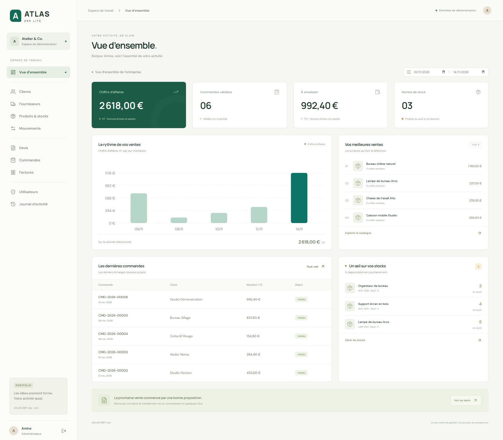

# ATLAS ERP Lite

[](https://github.com/AhmedAmine93/atlas-erp-lite/actions/workflows/ci.yml)

Mini-ERP de portfolio : **Next.js / React / TypeScript → Laravel / PHP → PostgreSQL**.



## État du projet

Les six modules métier sont implémentés. Au **16 novembre 2026** : 21 tests PHP passent sur PostgreSQL (162 assertions), 2 scénarios de concurrence passent et 29 vérifications HTTP passent. Le parcours navigateur client → devis à deux lignes → commande → facture PDF → payée a été exécuté, ainsi que la consultation sur mobile et le rôle lecture seule.

Le build de production Next.js et le contrôle TypeScript passent. Docker Compose est validé structurellement, mais **la construction et l’exécution des conteneurs restent à tester** : Docker Desktop n’a pas de moteur actif dans l’environnement de réalisation. Jenkins, Ansible, Kubernetes et la pile Prometheus/Grafana sont fournis, sans déploiement exécuté. Les scripts Playwright sont écrits et vérifiés par TypeScript, mais leur exécution CLI reste à faire. Voir [le rapport de tests](docs/TEST-REPORT.md) pour les preuves et limites.

## Fonctionnalités

| Module | Fonctionnalités disponibles |
|---|---|
| Administration | Connexion/déconnexion par session Sanctum, quatre rôles, CRUD utilisateurs, protection du dernier admin, audit |
| CRM | CRUD clients et fournisseurs, recherche, pagination, historique client |
| Catalogue et stocks | Référence, prix HT, TVA, catégorie, seuils, ajustements signés et journal immuable |
| Ventes | Devis et commandes multilignes, conversion unique, calcul serveur, validation atomique, verrouillage des stocks |
| Facturation | Brouillon, émission numérotée, déclaration de paiement, annulation, PDF, coordonnées et lignes figées |
| Dashboard | CA HT, commandes validées, encours TTC, meilleurs produits, graphique quotidien, période et alertes de stock |

Les données sont fictives. Les factures portent une mention de démonstration et n’ont pas de valeur comptable. Aucun paiement bancaire n’est intégré.

## Lancement avec Docker

Prérequis : Docker actif, Docker Compose v2 récent, Node.js 24.

```sh
node scripts/setup.mjs
docker compose up --build -d --wait --wait-timeout 180
```

Ouvrir **http://localhost:3100**. `setup.mjs` crée `.env` seulement s’il n’existe pas, génère les secrets techniques et prépare le jeton de monitoring. L’initialisation applique les migrations et le jeu de démonstration. Voir [DEVOPS.md](docs/DEVOPS.md) en cas d’échec ou pour les commandes de contrôle.

| Compte fictif | Rôle |
|---|---|
| `admin@atlas.example` | Administrateur |
| `commercial@atlas.example` | Commercial |
| `stock@atlas.example` | Stock |
| `reader@atlas.example` | Lecture seule |

Le mot de passe local de démonstration est généré dans `.env` par `setup.mjs`, configurable par `DEMO_PASSWORD` avant le premier chargement. En installation native, choisir un mot de passe de 12 caractères minimum dans `backend/.env`. Modifier ensuite `.env` ne change pas les mots de passe déjà créés. Ces accès ne doivent pas être publiés sur un service exposé à Internet.

## Installation native, testée sur Windows

Prérequis : PHP 8.3+ avec `pdo_pgsql`, `mbstring`, `openssl`, `fileinfo`, `dom`, `gd`, `zip` ; Composer 2 ; PostgreSQL 17 ; Node.js 24/npm. Les tests présentés ont utilisé PHP 8.4.27 et PostgreSQL 17.10. Les dépendances Composer sont résolues pour PHP 8.3.

Créer deux bases PostgreSQL, `atlas` pour la démonstration et `atlas_test` pour les tests. Utiliser un compte dédié et renseigner ses paramètres dans `backend/.env`.

```sh
cd backend
composer install
cp .env.example .env
# Adapter DB_HOST, DB_PORT, DB_DATABASE, DB_USERNAME et DB_PASSWORD.
php artisan key:generate
php artisan migrate --force
php artisan db:seed --force
php artisan serve --host=127.0.0.1 --port=8000
```

Dans un autre terminal :

```sh
cd frontend
npm ci
npm run dev -- --port 3100
```

Sous PowerShell, utiliser `Copy-Item .env.example .env` à la place de `cp` si nécessaire. Le frontend relaie `/api/*` vers `http://127.0.0.1:8000`. Pour un autre backend, définir `API_INTERNAL_URL` avant le build. Les polices sont incluses dans le projet ; aucune requête Google Fonts n’est nécessaire.

Pour servir la version compilée, arrêter le serveur de développement puis lancer `npm run build` et `npm run start -- --port 3100`. Ne pas lancer un build dans le même dossier pendant que `next dev` l’utilise.

## Tests

```sh
# Depuis backend : SQLite pour un contrôle rapide
php artisan test

# PostgreSQL : base dédiée et jetable, jamais la base de démonstration
DB_CONNECTION=pgsql DB_HOST=127.0.0.1 DB_DATABASE=atlas_test DB_USERNAME=atlas DB_PASSWORD=... php artisan test
DB_CONNECTION=pgsql DB_HOST=127.0.0.1 DB_DATABASE=atlas_test DB_USERNAME=atlas DB_PASSWORD=... php tests/concurrency.php

# Depuis la racine, services démarrés, exporter DEMO_PASSWORD depuis votre .env
node scripts/smoke.mjs

# Depuis frontend
npm run typecheck
npm run build
npx playwright install chromium
npm run test:e2e
```

Sous PowerShell, définir les variables avec `$env:DB_CONNECTION='pgsql'`, etc., puis exécuter la commande PHP. `phpunit.xml` utilise SQLite en mémoire par défaut ; les variables exportées permettent le test sur PostgreSQL. Le test de contrainte SQL spécifique est ignoré sur SQLite. Les commandes Playwright sont fournies pour reproduction, **pas annoncées comme exécutées**.

Le smoke HTTP crée des données `Smoke ...` et les conserve pour inspection. `ATLAS_URL` permet de changer sa cible. Les tests de concurrence reconstruisent uniquement une base dont le nom finit par `_test`. PHPUnit utilise aussi des migrations destructives sur sa base dédiée.

## API et architecture

- [OpenAPI 3.0.3 — 41 opérations](docs/openapi.json), également disponible à `/openapi.json` sur le frontend.
- [Architecture, décisions et préparation d’entretien](docs/ARCHITECTURE.md).
- [Schéma SQL PostgreSQL exporté](docs/schema-postgresql.sql). Les migrations Laravel restent la source de vérité ; ne pas importer le snapshot en plus des migrations.
- [Déploiement, CI et monitoring](docs/DEVOPS.md).
- [Rapport de tests](docs/TEST-REPORT.md) et [suivi de réalisation](docs/PROGRESS.md).
- [Capture mobile](docs/mobile.jpg). Un PDF de démonstration peut être généré depuis le module Factures.

Les requêtes d’écriture nécessitent une session et `X-CSRF-TOKEN`. Appeler `GET /api/csrf`, puis `POST /api/login`. Récupérer un nouveau jeton après connexion. Les autorisations sont vérifiées côté serveur ; masquer les boutons ne constitue pas la protection.

## Parcours de démonstration en cinq minutes

1. Se connecter comme administrateur et expliquer les indicateurs.
2. Créer un client, puis un devis avec deux produits.
3. Convertir le devis, valider la commande et montrer les sorties de stock.
4. Créer la facture, l’émettre, télécharger le PDF et la marquer payée.
5. Montrer le journal d’activité, puis se reconnecter en lecture seule.
6. Présenter les tests de stock concurrent et les limites recensées.

## Limites assumées

Application mono-entreprise, EUR, quantités entières, quatre rôles fixes. Pas de réservations de stock, achats/réceptions liés à un fournisseur, avoirs, retours, remises, modification de lignes de documents existants, paiement réel, MFA ou réinitialisation de mot de passe. Une annulation de facture conserve le numéro et ne restaure pas le stock. Les devis et commandes sont des documents de travail immuables après création dans cette version ; créer un nouveau document pour corriger les lignes.

Le frontend utilise une navigation interne à l’espace de travail ; il n’offre pas encore de liens profonds par module. Le composant principal est à découper davantage si le périmètre s’élargit. Le monitoring fourni expose des jauges métier, pas encore des métriques détaillées de latence ou de traces distribuées.

## Préparer GitHub

Le dépôt contient les sources et les lockfiles, sans dépendances installées ni secrets dans l’archive de livraison. Examiner `.gitignore`, puis :

```sh
git init -b main
git add .
git status
git commit -m "Initial ATLAS ERP Lite portfolio"
# Ajouter ensuite votre propre dépôt distant et publier.
```

Aucun dépôt distant n’a été créé ni publié automatiquement.

## CI/CD GitHub Actions

Les pull requests et les modifications de `main` lancent les contrôles métier PostgreSQL, les tests de concurrence, les parcours HTTP et Playwright et les audits des dépendances. Les images de production testées sont ensuite publiées sur GHCR sans reconstruction. Le déploiement manuel vérifie la provenance de la livraison et utilise ses digests, avec sauvegarde SQL et contrôle de santé. Aucun serveur n'est encore configuré.

Voir [l'architecture CI/CD et l'activation du serveur](docs/CI-CD.md). La configuration est en cours de validation : consulter le dernier résultat Actions, sans confondre un workflow écrit et un workflow exécuté.
