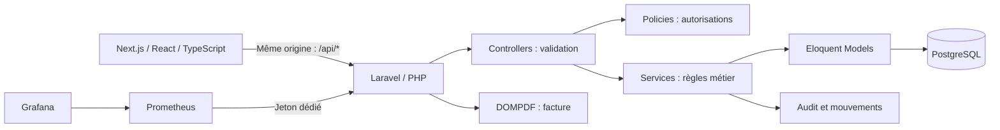
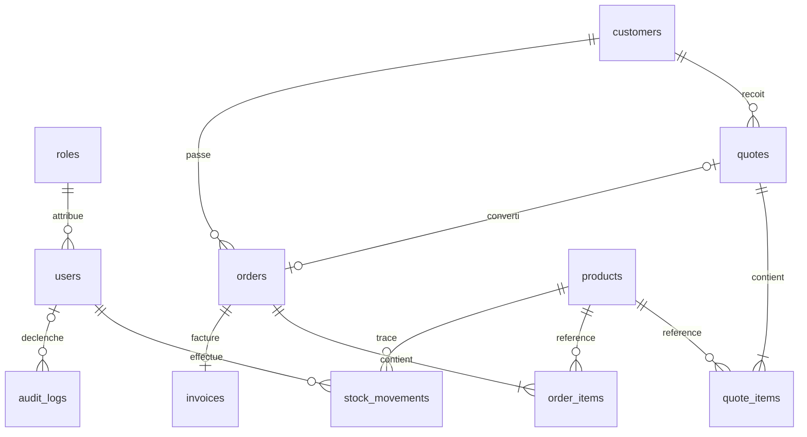
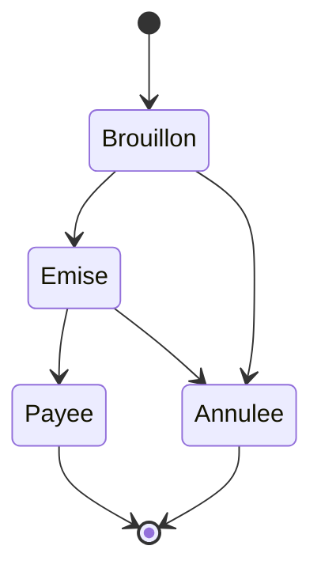

# Architecture et choix techniques — support d’entretien

## Vue d’ensemble

Le projet sépare le frontend et le backend en deux applications. Le proxy Next.js expose l’API sur la même origine que le navigateur. Cela simplifie l’authentification par cookie et évite de stocker un jeton d’accès dans `localStorage`. Laravel Sanctum protège les routes avec la session web, et les middleware web Laravel assurent la protection CSRF. Le client conserve seulement le jeton CSRF en mémoire et le recharge après connexion/déconnexion.

## Organisation

| Emplacement | Responsabilité |
|---|---|
| `frontend/src/components/Workspace.tsx` | Espace React et composants de dashboard, listes, formulaires et détails |
| `frontend/src/lib/api.ts` | Appels HTTP, gestion CSRF, erreurs et listes paginées |
| `frontend/src/lib/types.ts` | Contrats de données TypeScript |
| `backend/app/Http/Controllers` | Validation des entrées, choix du service et réponses HTTP |
| `backend/app/Services` | Calculs, numérotation, transactions, stocks, factures, audit |
| `backend/app/Policies/ErpPolicy.php` | Matrice des autorisations, enregistrée avec les Gates Laravel |
| `backend/app/Models` | Entités et relations Eloquent |
| `backend/database/migrations` | Contraintes, clés étrangères, index et évolution de la base |
| `backend/tests` | Tests unitaires, API et concurrence réelle entre processus |

Les formulaires sont validés côté navigateur pour le confort et côté serveur pour l’intégrité. Les listes sont paginées côté API. La consultation d’un client montre ses 100 dernières commandes. Les sélecteurs de clients et produits chargent les pages nécessaires ; pour un très gros catalogue, un sélecteur avec recherche distante serait préférable.

## Modèle relationnel

`suppliers` est un annuaire autonome dans ce périmètre. `document_sequences` attribue les numéros de documents. `sessions`, `cache`, `jobs` et `personal_access_tokens` sont des tables de support Laravel ; aucun token personnel n’est émis par l’interface actuelle.

La suppression d’une donnée référencée par un document ou un mouvement est empêchée par les clés étrangères et retourne un conflit HTTP 409. Le catalogue ne permet pas de modifier directement `stock` : toute évolution passe par une opération de stock auditée.

## Calculs monétaires

- Les montants sont des entiers en centimes. Les taux de TVA sont des points de base : 2000 = 20 %, 550 = 5,5 %.
- Pour chaque ligne : HT = prix unitaire × quantité ; TVA = arrondi arithmétique au centime ; TTC = HT + TVA.
- L’arrondi s’effectue par ligne avec division entière. Aucun nombre flottant n’est persisté pour les montants.
- Le serveur relit prix et TVA depuis le catalogue. Il ignore les prix ou totaux tentés par le client.
- Les quantités, prix et nombre de lignes sont bornés pour maintenir les calculs dans les capacités d’un entier 64 bits.

## Transaction de validation d’une commande

1. Ouvrir une transaction SQL et verrouiller la commande avec `FOR UPDATE`.
2. Vérifier qu’elle est encore en brouillon.
3. Verrouiller les produits par identifiant croissant, ce qui réduit les risques d’interblocage.
4. Contrôler puis débiter les quantités, insérer les mouvements et passer la commande à `validated`.
5. Écrire l’audit puis valider la transaction. En cas d’erreur sur une ligne, tout est annulé.

Deux commandes qui demandent la dernière unité ne peuvent pas toutes deux réussir. Le test de concurrence lance réellement deux processus PHP vers PostgreSQL ; il exige un succès, un refus, un seul mouvement et un stock nul. Un second test crée quatre documents en parallèle et vérifie six numéros distincts avec les deux commandes préparatoires.

Les contraintes PostgreSQL complètent les services : stock non négatif, quantité positive, valeurs monétaires cohérentes et statuts autorisés. Les mêmes garanties de concurrence ne sont pas revendiquées sur SQLite, utilisé uniquement pour les tests rapides.

## Documents et factures

Les prix et noms des lignes sont copiés à la création du devis ou de la commande. La conversion conserve les conditions commerciales du devis et ne peut avoir lieu qu’une fois (`quote_id` unique + verrou). Les factures ne sont créées qu’à partir d’une commande validée et une commande n’a qu’une facture.

Le snapshot de facture contient les coordonnées du client, du vendeur, le numéro de commande et les lignes. Les modifications ultérieures du CRM/catalogue n’altèrent donc pas le PDF. Le numéro `FAC-AAAA-NNNNN` est attribué à l’émission, à l’aide d’une séquence verrouillée et d’une contrainte d’unicité. Un numéro annulé n’est pas réutilisé.

Le statut payé est une déclaration manuelle, sans transaction bancaire. Une facture payée ne peut pas être annulée dans cette version. Un futur module d’avoirs devrait traiter les corrections comptables et les éventuels retours physiques séparément.

## Autorisations et sécurité

| Action | Admin | Commercial | Stock | Lecture seule |
|---|---|---|---|---|
| Consulter les modules métier | Oui | Oui | Oui | Oui |
| Modifier CRM, devis, commandes, factures | Oui | Oui | Non | Non |
| Modifier catalogue et stocks | Oui | Non | Oui | Non |
| Utilisateurs, rôles et audit | Oui | Non | Non | Non |

Les Gates s’appuient sur une Policy, indépendamment des boutons visibles. Les mots de passe sont hachés et retirés des réponses JSON. Une modification d’utilisateur supprime ses sessions persistées. La ligne du rôle admin est verrouillée pour préserver le dernier administrateur en cas de modifications concurrentes. Le contrôle anti-CSRF s’applique aussi à la connexion. Les tentatives de connexion sont limitées à cinq par minute, par couple e-mail/IP.

Les recherches utilisent des paramètres SQL liés. React et Blade échappent les textes ; aucun HTML utilisateur n’est rendu intentionnellement. Les réponses API ne sont pas mises en cache. L’audit exclut mots de passe et jetons. Les erreurs de contrainte ne divulguent pas le SQL au client.

## Définition des indicateurs

CA = somme HT des factures émises ou payées, selon leur date d’émission. Encours = TTC des factures émises non payées dans la période. Commandes et meilleures ventes = commandes validées selon leur date de validation. Les factures annulées et brouillons ne contribuent pas au CA. Les alertes de stock et dernières commandes présentent l’état courant, indépendamment du filtre de période.

## Choix et compromis à expliquer

**Pourquoi Laravel ?** Les migrations, ORM, validation, sessions, politiques et transactions sont cohérents et testables dans un framework PHP mature.

**Pourquoi PostgreSQL ?** Il fournit les contraintes et verrous nécessaires aux règles de stock et de numérotation ; le projet utilise de vrais tests PostgreSQL au-delà des tests en mémoire.

**Pourquoi pas Redis au départ ?** Les sessions et le cache fonctionnent en base. Pour cette démonstration, ajouter un service ne résout pas de problème mesuré. Redis reste une évolution possible pour une charge plus élevée.

**Pourquoi un monolithe métier ?** Le périmètre est limité et transactionnel. Extraire des microservices rendrait la cohérence du stock et des documents plus complexe sans bénéfice démontré.

**Que reste-t-il avant une production réelle ?** Certification et règles comptables, avoirs, sauvegarde/restauration testée, HTTPS et secrets gérés, revue de sécurité, MFA/récupération de compte, supervision des erreurs et latences, tests navigateur en CI et test réel de l’infrastructure. La version actuelle est une démonstration portfolio, pas un logiciel comptable certifié.

## Références techniques

- [Laravel Sanctum](https://laravel.com/framework/docs/12.x/sanctum)
- [Next.js : installation et environnement](https://nextjs.org/docs/app/getting-started/installation)
- Le code livré verrouille les versions dans `composer.lock` et `package-lock.json`. Les dépendances doivent être réévaluées lors d’une mise à jour.
