# Architecture CI/CD

## Flux de livraison

```mermaid
flowchart LR
  PR[Pull request ou push main] --> Build[Images production + image tests]
  Build --> PHP[PHPUnit + concurrence PostgreSQL]
  PHP --> E2E[HTTP + Playwright sur images production]
  E2E --> Audit[Audits Composer et npm]
  Audit --> Evidence[Rapports conservés 14 jours]
  Evidence -->|main seulement| GHCR[Publication GHCR sans reconstruction]
  GHCR --> Manifest[Artefact release : commit et digests]
  Manifest -->|Déclenchement manuel| Env[Environnement demo]
  Env --> Backup[Sauvegarde SQL + migrations]
  Backup --> Health[Démarrage + contrôle HTTP]
  Health -->|échec| Previous[Retour aux images précédentes]
```



Les pull requests ont uniquement un jeton en lecture. Seul le job de publication sur `main` reçoit `packages: write`. Les actions tierces sont fixées par SHA et suivies par Dependabot. Aucune action `pull_request_target` n'exécute de code non fiable avec des secrets.

`scripts/ci.sh` est partagé entre GitHub Actions et l'adaptateur Jenkins. Les 21 tests PHP utilisent PostgreSQL, les tests de concurrence des processus PHP distincts. La base de test est séparée de celle du parcours navigateur. Les volumes de CI sont jetables ; le nettoyage conserve les rapports. Le backend de production ne contient pas PHPUnit. Les images testées sont exportées puis chargées dans le job de publication, sans nouveau build. Les étiquettes `sha-<commit>` permettent la traçabilité ; **le déploiement utilise les digests**, insensibles au remplacement d'une étiquette.

Les images sont `ghcr.io/ahmedamine93/atlas-erp-lite-backend` et `ghcr.io/ahmedamine93/atlas-erp-lite-frontend`. Leur visibilité GHCR peut rester privée même si le dépôt est public : le serveur doit alors disposer d'une connexion Docker avec un jeton limité à `read:packages`, configurée directement sur le serveur. Ne pas mettre ce jeton dans le dépôt.

## Préparer le premier serveur

Aucun serveur n'est actuellement configuré. Le workflow de déploiement n'est donc pas exécuté. Cible prévue : Linux, Docker Compose v2, SSH, Bash, curl, gzip et flock. Le compte de déploiement doit pouvoir utiliser Docker et écrire dans `/opt/atlas`. Le playbook Ansible existant est une base de préparation, pas un déploiement déjà validé.

1. Créer `/opt/atlas/releases` et `/opt/atlas/backups` avec accès limité au compte de déploiement.
2. Créer `/opt/atlas/.env` hors Git (permissions 600), à partir de `.env.example`. Renseigner une clé APP_KEY stable, un mot de passe PostgreSQL, un mot de passe de démonstration unique, APP_URL en HTTPS, SESSION_SECURE_COOKIE=true. Ne jamais utiliser le mot de passe public de la démo sur Internet.
3. Installer un reverse proxy HTTPS devant `127.0.0.1:3100`. Aucun accès public à PostgreSQL, PHP-FPM ou au proxy API interne.
4. Dans GitHub Settings → Environments, créer `demo`, restreindre les branches à `main` et configurer une approbation si désirée. Ce réglage de protection n'est pas créé par le YAML.
5. Dans cet environnement, définir les variables `DEPLOY_HOST`, `DEPLOY_USER`, puis les secrets `SSH_PRIVATE_KEY`, `SSH_KNOWN_HOSTS`. Vérifier l'empreinte SSH avec l'administrateur avant de la renseigner ; aucun `StrictHostKeyChecking=no` n'est utilisé.
6. Choisir un run **CI and images** entièrement réussi sur `main`. Lancer **Deploy tested release** avec son identifiant numérique. Le workflow vérifie le résultat, l'événement, la branche et le fichier du workflow avant de récupérer les références d'images.

Le serveur ne reconstruit pas le code. Il tire les images, démarre la base, arrête brièvement les écritures, sauvegarde PostgreSQL, applique les migrations, puis attend le bon état des services et vérifie que `/api/me` renvoie 401 sans session. Une première installation possède les rôles mais pas d'utilisateurs. Pour charger explicitement les données fictives avec le mot de passe privé configuré :

```sh
cd /opt/atlas/current
docker compose -p atlas-prod --env-file /opt/atlas/.env --env-file release.env -f compose.production.yaml run --rm migrate php artisan db:seed --force
```

Les sauvegardes restent sur le serveur. Prévoir une copie chiffrée hors serveur, une rétention et un test de restauration avant toute exploitation réelle. Le volume PostgreSQL n'est jamais supprimé par `deploy.sh`.

## Retour arrière et limites

`/opt/atlas/current` pointe vers la dernière livraison réussie, `/opt/atlas/previous` vers la précédente. En cas d'échec après arrêt des services, le script tente de redémarrer les images précédentes et conserve le code de sortie d'échec. La base n'est **jamais restaurée automatiquement** : une migration incompatible nécessite une maintenance et une restauration contrôlée. Privilégier des migrations compatibles avec les deux versions successives.

Pour redéployer une ancienne version compatible, relancer le workflow avec l'identifiant de son run réussi tant que son artefact `release` existe (90 jours). Conserver séparément les manifestes de versions destinées à vivre plus longtemps. Les artefacts d'images de transfert expirent après un jour ; GHCR conserve les images publiées.

Architecture mono-serveur avec interruption brève, sans haute disponibilité ni déploiement sans interruption. Les bases Docker tierces sont fixées par version majeure/mineure, pas encore par digest. Le workflow de CI doit être exécuté pour confirmer les images et Playwright ; le rapport de tests décrit les validations réellement obtenues. La protection de `main` et les approbations d'environnement se configurent dans GitHub, elles ne sont pas implicitement actives.

## Références

- [GitHub : publication d'images](https://docs.github.com/en/actions/tutorials/publish-packages/publish-docker-images)
- [Docker : tester avant de publier](https://docs.docker.com/build/ci/github-actions/test-before-push/)
